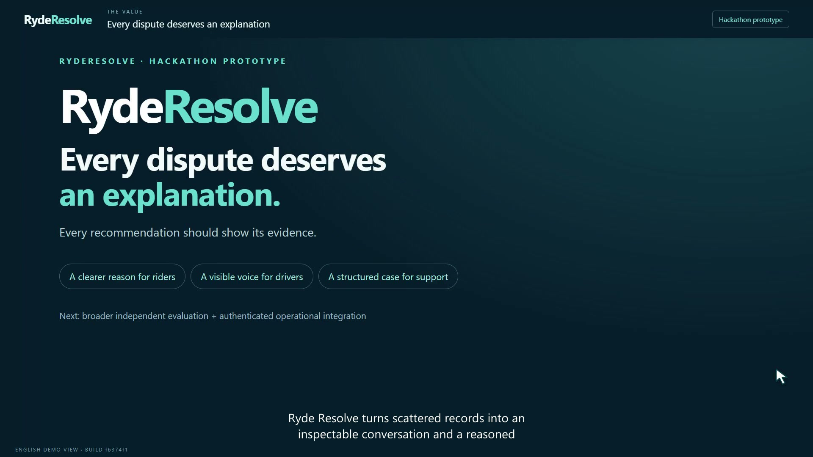

# RydeResolve competition demo

[Download the English demo video](RydeResolve-Demo-English-1080p.mp4) · [English captions](RydeResolve-English.srt) · [Narration transcript](RydeResolve-English-transcript.txt)

The **6 minute 58.5 second** video presents the rider, driver and support-team problem, demonstrates the Agent workflow, and reflects on the build and development tools. It has English neural narration, burned-in English captions, real browser interactions with a visible cursor, and 19 embedded chapter markers. Format: 1920 × 1080, 25 fps, H.264/AAC, approximately 36 MiB.

| Time | Content |
| --- | --- |
| 0:00 | User problem and product value |
| 0:42 | Evidence, two advocates, Judge and checks |
| 1:04 | Fare dispute: source evidence, policy, responses and refund suggestion |
| 3:10 | No-show uncertainty and mandatory route review |
| 3:55 | Workbench, synthetic material preview and human-outcome form |
| 5:00 | Recovery, evaluation limits, build reflection and development-tool tips |
| 6:34 | Value and next steps |

The capture baseline is team `main` at **fb374f1**, checked against GitHub on 16 October 2026. The fare report is a saved real model result from that date; route, no-show and workbench controls use offline providers. These modes are labeled in the video. The English interface is an editorial translation overlay for this recording, not a production localization. No runtime source or official attachment was changed, no new paid Agent call was made, and no refund or human outcome was saved. The synthetic supplement was previewed without committing a rerun.

The accompanying [media QA report](media-qa.json) records full decoding, dimensions, chapter count, audio measurements, subtitle/script consistency, official-source hashes and sampled visual review. It verifies the video artifact; it is not a new evaluation of model accuracy. Speech uses `en-US-AriaNeural` at +15%. There is no background music.

Production sources and reproduction instructions are in [tools/demo_video](../../tools/demo_video/README.md). Intermediate recordings, speech cache, previews, checkpoints and machine-specific configuration remain local.

**Review copy only.** This repository is private. The video has not been published publicly or submitted to the competition. The owner will review it before choosing a judge-accessible hosting location. When uploading, the subtitles are already visible in the MP4; avoid displaying a second duplicate caption layer.
